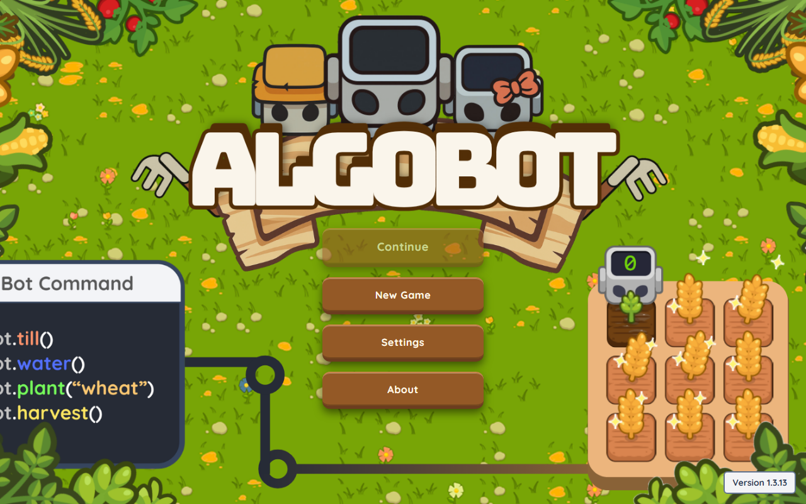

# Algobot

**Algobot: A 2.5D Game for Algorithmic Logic Skills Using Recurrent Neural Networks.** An undergraduate thesis at City College of Calamba.

Algobot is a browser game for first-year computer science students. Players use Blockly blocks or JavaScript to move farm robots, plant and water crops, harvest produce, and respond to pests and fire. Guided quests introduce programming concepts through tasks on the farm.

[Play Algobot](https://algobot.fun)



## Gameplay

- Follow 44 quests: 38 required quests, an optional return-value lesson, and five optional crop quests.
- Practice commands, loops, conditions, variables, comparisons, functions, and lists in either editor.
- Use lesson practice tiles and progressive hints to retry a program and understand what went wrong.
- Earn coins and experience, unlock crops, expand the farm, and program multiple robots.
- Manage crop growth, soil moisture, spoilage, weather, and hazards.

The [quest guide](documentation/QUEST_PATH_V2.md) describes the curriculum, completion rules, hints, and lesson protection. The [farm systems guide](documentation/FARM_LIFECYCLES_AND_WEATHER.md) covers crop and weather behavior.

## New Game and Continue

Algobot automatically saves one playthrough in the browser. Continue restores the farm, quests, inventory, robots, and editor programs after a reload or browser restart. New Game asks for confirmation before replacing an existing playthrough.

Growth, spoilage, hazards, and other simulation timers pause while the game is closed. Restored programs remain stopped until the player runs them again.

Saves belong to the browser profile and site address where the game was played. They do not transfer between devices or domains. Clearing site data removes local progress. Research uploads are separate archives for the study; they do not provide cloud saves or restore a farm on another device.

## Adaptive difficulty

Algobot records gameplay for research and uses a browser-based LSTM with explicit difficulty rules. The current model predicts a first-harvest task score from recent gameplay. It is provisional and has not been validated as a reliable measure of general programming proficiency. DQN is not used in live inference. The [model card](public/models/lstm/model-card.json) and [deployment record](documentation/MODEL_DEPLOYMENT_2026-10-05.md) describe the active model and its limitations.

## Run locally

Use Node.js compatible with Vite 7 and npm. Development has been verified with Node 24.19.0 and npm 11.17.0. Chromium is the supported browser target.

```sh
npm ci
npm run dev
```

Open the local address printed by Vite. To build and preview the production bundle:

```sh
npm run build
npm run preview
```

Python is only needed for the research data and training tools. See [Windows setup](SETUP_GUIDE.md) and the [model workflow](documentation/MODEL_WORKFLOW.md) for those dependencies.

## Tests

```sh
# Unit and regression tests
npm test

# Install the browser once, then run the Chromium suite
npx playwright install chromium
npm run test:e2e:chromium

# Browser uploads through local workerd and disposable local R2 storage
npm run test:upload:integration

# Check preserved research artifacts; requires the historical Git commits
npm run verify:artifacts
```

The [save/load verification record](documentation/SAVE_CONTINUE_VALIDATION.md) documents automated checks. The [manual campaign record](documentation/save-load-manual-review/STATUS.md) tracks three completed 44-quest playthroughs and the remaining fault and endurance cases. It also records an open canvas-resize issue; reloading restores the layout after enlarging a small viewport.

## Project structure

| Path | Contents |
| --- | --- |
| `src/components/` | Svelte interface, editors, menus, and research controls |
| `src/game/` | KAPLAY game systems, quests, persistence, and ML runtime |
| `public/` | Game assets and browser model files |
| `upload-worker/` | Cloudflare upload service and deployment configuration |
| `tests/` | Unit tests, Chromium scenarios, and upload integration tests |
| `training/` | Research preparation and model training tools |
| `documentation/` | System guides, protocols, and verification records |

The interface uses Svelte 5, the farm uses KAPLAY, and TensorFlow.js runs the model locally. Both editors execute student programs through the game's interpreter.

## Deployment and research data

Deploying to Cloudflare, the upload Worker, research-data collection and the collection dashboard are documented in [documentation/DEPLOYMENT.md](documentation/DEPLOYMENT.md).
